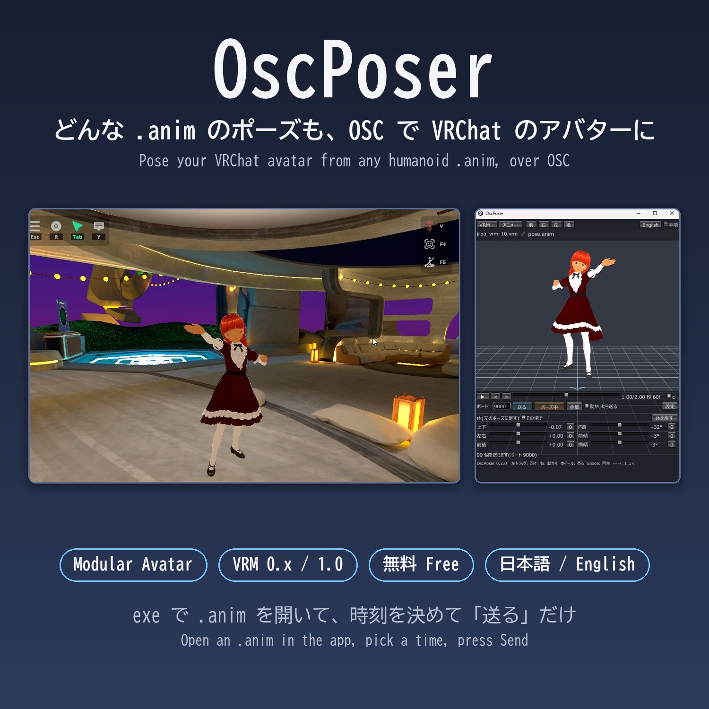
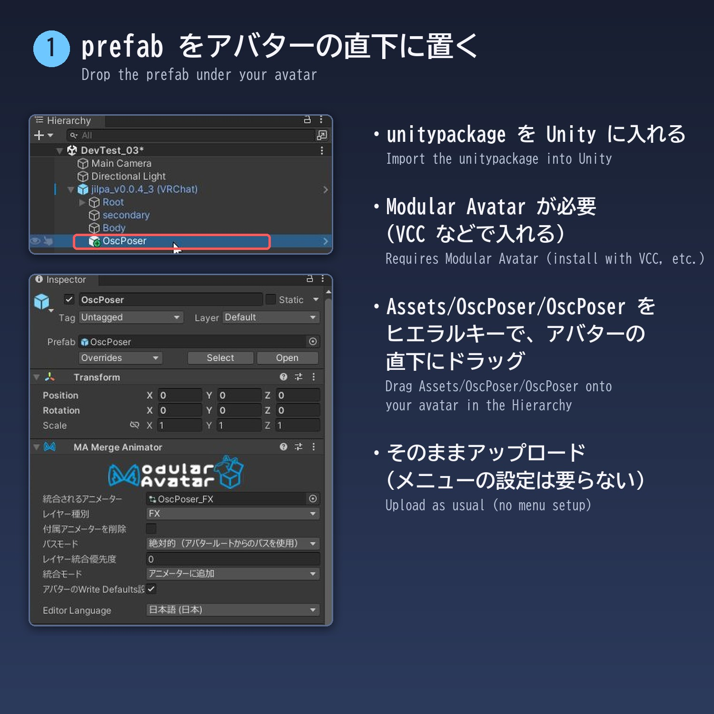
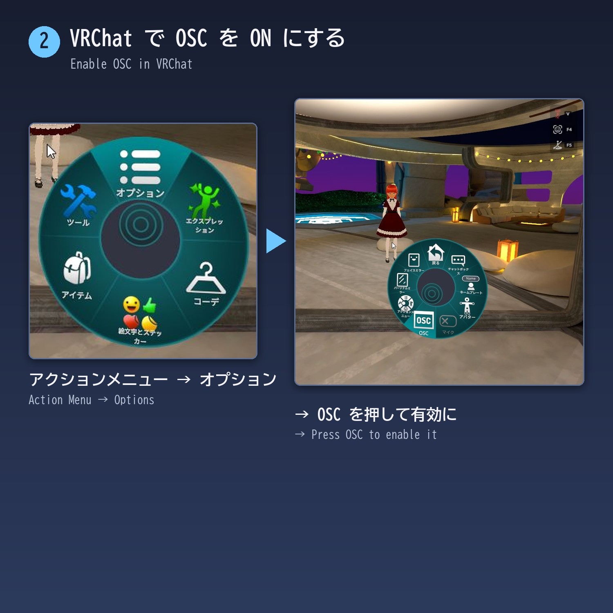
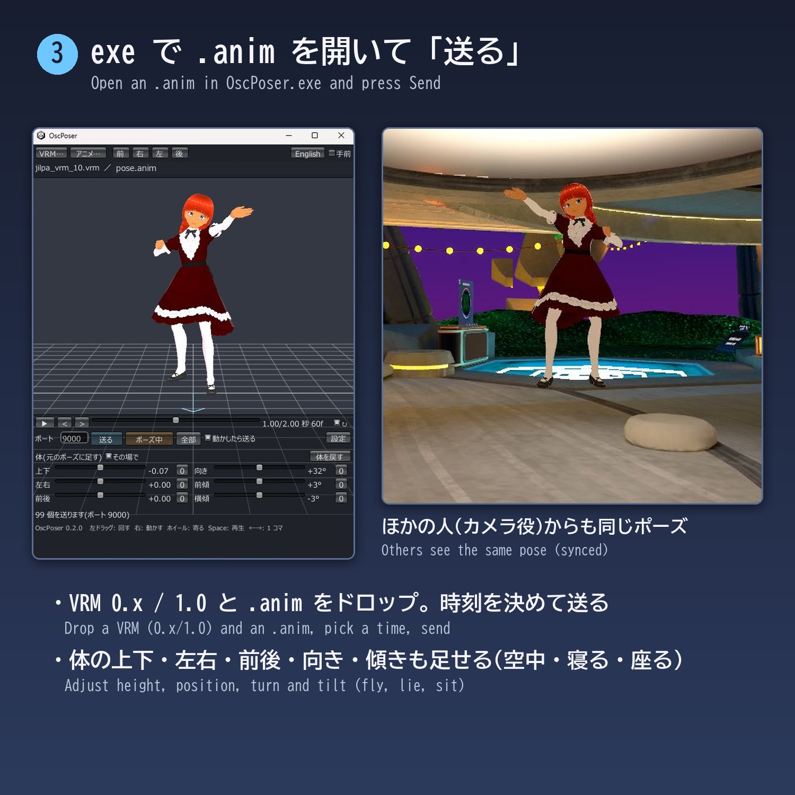
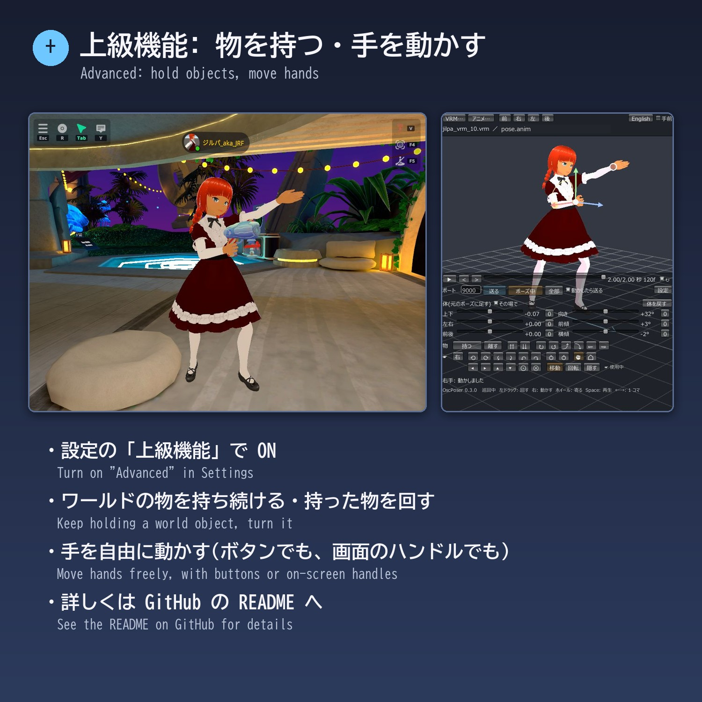

# OscPoser

Pose your VRChat avatar from any humanoid .anim later, over OSC.
OscPoser is a Modular Avatar prefab plus a small app (exe) that shows the pose and sends it.
Set up the prefab and upload once; after that, you don't need to open Unity to use new poses.

(日本語: [README.md](README.md))

This is a tool that Claude Code (Claude Opus 5.5) made to order for me (JRF), shared in case it helps others. I use it to photograph avatars when I report on VRChat worlds.

This is an unofficial tool, not affiliated with VRChat.
It is also unrelated to [OSCPoser by ymchn](https://github.com/ymchn/OSCPoser), which is for Cluster and has a similar name.

## What it does

- Put one prefab on your avatar and upload. Your avatar can then take any pose sent over OSC. No Expressions menu setup is needed.
- Drop a VRM and an .anim onto the app, pick a moment on the timeline, and press Send. Your avatar in VRChat takes that pose.
- You can also add height, sideways and forward offsets, turn, and tilt. This lets you float in the air, lie down, or sit on nothing, which emotes can't do.
- The pose is synced, so other people (such as a camera person) see the same pose. After sending, the app keeps resending the values slowly (cycle send), so missed values and the pose seen by people who join later fix themselves.
- An .anim with only some parts, such as the hands or the upper body, can be layered on the current pose (for example, to change just the hand shape).
- Advanced features (turn on in Settings): keep holding a world object, turn the held object, and move the pose's hands freely (☛). See [below](#advanced).
- An AI such as Claude can control it over MCP (`-api`). See [below](#mcp).
- The app shows both VRM 0.x and 1.0. The app's UI is in Japanese and English.

## Requirements

- Windows 10 / 11 (64-bit). The app is for Windows.
- VRChat (PC). I have tested it in desktop mode.
- **Modular Avatar** in your avatar's Unity project (Unity 2022.3, VRChat SDK3 Avatars). Install it with VCC (or ALCOM, etc.).
- A VRM file with the same body as your avatar (for the app's preview, for example one exported from VRoid Studio). You can send poses without it, but you can't see them while choosing.
- Humanoid animation .anim files (text format). The ones in your Unity project or in assets work as they are. Animations inside FBX files can't be read.

## Install

Download the zip from [Releases](https://github.com/JRF-2018/osc_poser/releases) or Booth, and extract it anywhere.

1. Install Modular Avatar into your avatar's Unity project with VCC (or ALCOM, etc.).
2. Import `OscPoser_x.y.z.unitypackage` from the zip into Unity (drag it in, or use Assets → Import Package → Custom Package).
3. In the Hierarchy, drag `Assets/OscPoser/OscPoser` (the prefab) onto your avatar so it is directly under the avatar.
4. Upload as usual.

5. In VRChat, open the Action Menu → Options → OSC and turn it on.

## Usage

1. In VRChat, wear the avatar with the prefab.
2. Start `OscPoser.exe` and drop a VRM and an .anim onto the window (or use the "VRM…" and "Anim…" buttons). The app remembers the last VRM.
3. Choose the moment you want on the timeline at the bottom (▶ plays, < > steps one frame).
4. Press "Send". When all values are sent, the pose turns on.
5. Press "Pose ON" to turn it off. Your avatar goes back to normal and can walk.

### Controls

| Control | What it does |
|---|---|
| Port | VRChat's OSC input port. Usually leave it at 9000 |
| Send | Send the current pose and turn the pose on. Only values that changed since the last send are sent |
| Pose ON / Pose OFF | Turn the pose on or off |
| All | Resend every value (after you reload the avatar in VRChat, or for people who joined the instance later) |
| Auto send | When you move the timeline or a body slider and stop, the changed values are sent. Paused at startup and after opening an .anim, until you press Send |
| Body (added to the pose) | Up, Side and Fwd (±1.5 in humanoid units), Turn (±180°), Pitch (±180°), Roll (±90°). "0" resets one axis, "Reset body" resets all |
| In place | Ignore the animation's sideways and forward movement (on by default) |
| Settings | Sending speed (see "How it works" below), cycle send, advanced features |
| Cycle send (Settings) | After sending, keep resending the sent values one pair at a time, in shuffled order (on by default; 0.3 s per pair, so 99 values take about 30 s per round). It starts after your first send and keeps going while the pose is OFF. It resends what was sent, not values you are still editing |
| Advanced (Settings) | Show the rows for holding objects and moving hands (☛). "☛ cm" and "deg" are the ☛ step sizes |
| On top | Keep the app window on top |
| 日本語 / English | UI language |

Mouse: left drag to orbit, right drag to pan, wheel to zoom. Keys: Space to play, ← → to step one frame, F for the front view.

### Layering a partial pose

If an .anim has less than 80% of the main body muscles (not counting fingers, eyes and jaw), for example only the hands or only the upper body, opening it layers just its values on the pose you see now (the top line shows "base + layer"). Body height and rotation are copied too if the clip has them. Use the timeline to pick the layer's moment. Opening a full-body .anim clears the layers. The next start resumes with the layers as they were.

### Opening a pose .json

A pose .json saved with the MCP tool `save_pose` can be dropped and opened like an .anim (partial values are layered on the current pose).

### A window for another account (port)

When you run two or more VRChat clients (for example `launch.exe --profile=1 --osc=9010:127.0.0.1:9011`) to pose different avatars, start `OscPoser.exe -port 9010` to get a window for that port. A shortcut with ` -port 9010` added at the end of its target is handy. The last VRM, animation and time are remembered per port (without changing the settings of a window started without `-port`).

To handle several avatars in one window, start `OscPoser.exe -targets 9000,9010,9020`. The screen is the same, but changing the Port field switches to that port's own VRM, pose, body, hands and sending (cycle send keeps going for the other ports too). `-target 1` picks which one to show first (from 0). From AI or scripts, add `port` to a tool or command to work on that port.

`OscPoser.exe -help` (or `/?`) lists the command-line options.

### With other emotes

- If you choose another emote while posing, the pose ends and that emote plays.
- If you press Send during an emote, the emote is stopped, and the pose starts after a short wait (0.6 s).

## How it works, and notes

- Only 17 bits of sync are used (`OscPoser/On` Bool, `OscPoser/Idx` Int, `OscPoser/Val` Float). The pose values (93 muscles and 6 body values) are copied into unsynced parameters, one index and value pair at a time. A Parameter Driver Copy runs on everyone's side, so other people see the same pose.
- Each pair takes about 0.125 s, so all 99 values take about 12 s. For another moment of the same animation, only the changed values are sent, so it is faster. While values are being sent, the pose changes little by little.
- If the index changes faster than the sync interval, other people can miss values. If the pose looks wrong to a camera person, make the waits longer in "Settings" (defaults: 0.025 s after a value, 0.1 s after an index, 0.1 s after 0, and "No 0" on).
- People who join the instance later don't receive the earlier values. With cycle send on, they get them in about 30 s. To hurry, press "All" to resend them.
- Even with longer waits, a whole send occasionally does not arrive, and the pose stays as it was (the cause is unknown, and it is hard to reproduce). With cycle send on, it fixes itself after a while. To hurry, press "All" to resend everything. "Send" sends only the changed values, so values that were lost may stay wrong.
- If you add the prefab to an avatar you uploaded before, VRChat's OSC config file for that avatar may be out of date, and the new parameters may not arrive. In that case, press Action Menu → Options → OSC → Reset Config, or delete that avatar's config file in `%USERPROFILE%\AppData\LocalLow\VRChat\VRChat\OSC\`.
- Muscle values go up to ±4 (emotes often use values above 1). Body position goes up to ±1.5, turn and pitch up to ±180°, and roll up to ±90°.
- The pose runs in the Action layer (Modular Avatar adds it to your avatar's Action). The layer that copies values is added to FX. It works even if your avatar uses its own FX (such as XAvatar).
- Tested with: VRChat (PC, desktop mode), a VRoid VRM 0.x avatar converted with VRM Converter for VRChat, and an XAvatar (XWear Packager). Not tested in VR mode.

## Advanced features (holding objects, moving hands)

Check "Advanced" in "Settings" to show three more rows. I made these to photograph avatars holding world objects when I report on worlds. Hover over a button to see what it does.

### Obj (world pickups)

| Button | What it does |
|---|---|
| Grab | Aim VRChat's crosshair at the object, then press. The app brings VRChat's window to the front (objects can only be grabbed while VRChat's window is in front), grabs, and keeps holding by re-pressing every second. Then it comes back to the OscPoser window. If VRChat's window is not found, it waits 3 s so you can click it. On desktop only the right hand can hold |
| Release | Let go of the held object |
| ⇈ ⇊ | Move the object away / closer with OSC MoveHoldFB. **As of 2026-11, this does not work in desktop VRChat, for unknown reasons.** It is here in case a VRChat update makes it work. For now, use the mouse wheel in VRChat's window |
| ↻ ↺ ⤴ ⤵ ⇜ ⇝ | Turn the held object (while pressed, about 4.6° per step). Works with VRChat's window in the background |

On desktop, a held object stays in front of the view, so with a pose it floats away from the hand. Watch the camera person's view and use the body sliders and object turning to put it in the hand.

### ☛ Moving hands

Moves one hand of the pose. The arm is decided by the wrist position, the hand rotation and the elbow swing, so you can change each separately (solved by IK).

| Button | What it does |
|---|---|
| R / L | Hand to move |
| ⟲ ⟳ ⤹ ⤸ ↶ ↷ | Twist, bend, and bend the wrist sideways (wrist position stays) |
| ⥁ ⥀ | Swing the elbow away from / toward the body (wrist position and rotation stay) |
| ✊ | Fingers: light grip / from the pose |
| ⌂ | Put this hand back to the pose |
| ◂ ▸ ▴ ▾ ⊙ ⊗ | Move the wrist left, right, up, down, forward, back (rotation and elbow stay) |
| Move / Rotate / Hide | Switch the on-screen handles (below). Keys W / E / Q also work |

You can also drag handles in the 3D view, like in Unity (they move the same things as the buttons).
- At startup no hand is selected. Click the small white circle on a wrist to select that hand. Clicking elsewhere deselects.
- **Move (W)**: red, green and blue arrows move along the feet's right, up and forward. Dragging the white ball moves along the screen; while you hold it, the wheel also moves away from / toward you along the view (1 cm per notch).
- **Rotate (E)**: red, green and blue rings turn around the hand bone's three axes.
- **Elbow**: a yellow ring (around the shoulder–wrist line) and a yellow ball on the elbow. Drag the ball along the ring to swing the elbow (wrist position and rotation stay). Shown in both modes.
- Click the white ball (without moving) to switch between Move and Rotate. Dragging away from the handles orbits the view as usual.
- If you start again with the same VRM, animation and time, the moved hands come back too.
- Body position and tilt use the sliders (no on-screen handles).

- The opposite button undoes. Out of reach, the hand goes as far as it can.
- Changing the time or animation puts the hands back to the pose. Body offsets move the hands with the body. Layering a hands-only .anim gives its finger shape.
- Results are sent like any other change, by Auto send or Send.
- Step sizes (3 cm and 15° by default) are in Settings. Use a VRM with the same body as your VRChat avatar.

### Parameters (for other tools)

To send: set `OscPoser/Val` to a value (-1 to 1) → wait a little → set `OscPoser/Idx` to the index → wait → (next pair) → finally set `OscPoser/Idx` to 0. Set `OscPoser/On` to true to turn the pose on.

| Index | Meaning | Value ±1 means |
|---|---|---|
| 1–93 | Humanoid muscles (order: `MuscleNames` in [PoseParams.cs](app/Assets/OscPoserApp/Scripts/PoseParams.cs)) | muscle ±4 |
| 94 / 95 / 96 | Body up / side / forward (RootT.y − 1 / x / z) | ±1.5 |
| 97 | (unused) | |
| 98 / 99 / 100 | Body yaw / pitch / roll, in Unity's YXZ order | ±180° / ±180° / ±90° |

## Using it from AI (MCP)

Start `OscPoser.exe -api` (or `-api 9331` for another port) and a control port opens that only this PC can reach. An AI such as Claude can then use OscPoser as MCP tools: open a pose, pick the time, send, turn on/off, body offsets, move hands (☛), read and save the pose, grab/release/turn held objects, and take a screenshot of OscPoser's view to look at. You can ask things like "open the peace sign and show me from the right" or "raise the right hand 5 cm". Opening does not send; `send_pose` does.

- Claude Code (Windows): `claude mcp add --transport http oscposer http://127.0.0.1:9330/mcp`
- Clients that can only use stdin/stdout (Claude Desktop's config, Claude Code inside WSL, etc.) can use `oscposer_mcp.ps1` from the zip, a bridge that needs only Windows PowerShell: `claude mcp add oscposer -- powershell.exe -NoProfile -ExecutionPolicy Bypass -File "C:\...\oscposer_mcp.ps1"`
- Start OscPoser with `-api` before starting the AI side (adding ` -api` at the end of a shortcut's target is handy).
- Add `port` to a tool or command to work on that port. A normal start only talks to the port shown in the window, so switch with `set_port` first, or start with `-targets`.
- Tools: `get_state`, `open_vrm`, `open_animation`, `open_pose`, `set_time`, `send_pose`, `set_pose_on`, `set_body`, `move_hand`, `get_pose_values`, `save_pose`, `held_object`, `screenshot`, `stop_sending`, `set_port`.
- `screenshot` captures OscPoser's window. To let the AI see VRChat itself (for example the camera person's view), combine it with another MCP that captures the screen.
- The same port also takes plain HTTP (`GET /state`, `POST /cmd` with JSON such as `{"cmd": "anim", "path": "...", "time": 0.5}`), for scripts.
- Safety: it listens on 127.0.0.1 only, so other PCs can't reach it. Requests from web pages in a browser (with an Origin header) and requests with another host name are refused. `save_pose` writes only .json, and screenshots only .png.

## Earlier tools

There are earlier tools for giving your avatar free poses in desktop VRChat, using OSC and other means (I learned about them after publishing OscPoser). If you want to do more elaborate things, please check them out too.

- ["ポーズ送り" (Pose Sender)](https://booth.pm/ja/items/8715878) by negilemon
- [VRChat Desktop Pose OSC Tool (VRCDP)](https://booth.pm/ja/items/8837110) by RIOKUN

OscPoser is a small tool for making your avatar take poses from .anim files you already have, for photos.

## Building from source (for developers)

- `unity/`: an editor script that builds the prefab (`Assets/OscPoser`). Create an Avatar project with VCC (or ALCOM, etc.), install Modular Avatar, copy `unity/Assets/OscPoserDev` into its `Assets`, and run Tools → OscPoser → Build. Tools → OscPoser → Export unitypackage writes the unitypackage.
- `app/`: the Unity project for the app (Unity 2022.3.22f1, UniVRM 0.128.1). `app/build.ps1` builds it in batch mode (the output folder is `$Out` in the script).

## Author

JRF ( http://jrf.cocolog-nifty.com/statuses , Twitter (X): @jion_rockford )
AI

Claude Opus 5.5 wrote most of it.

## License

MIT License (LICENSE).

The app includes UniVRM (MIT License). See [THIRD_PARTY_NOTICES.md](THIRD_PARTY_NOTICES.md).
