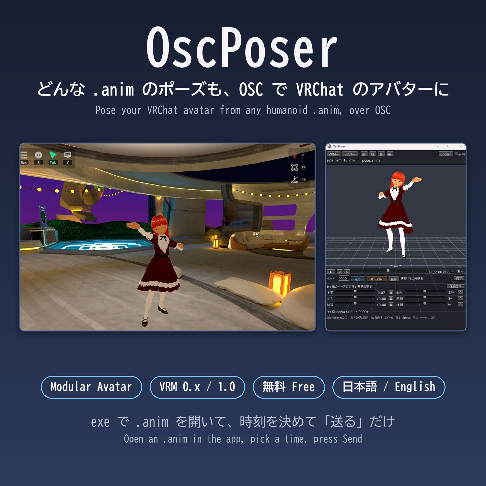
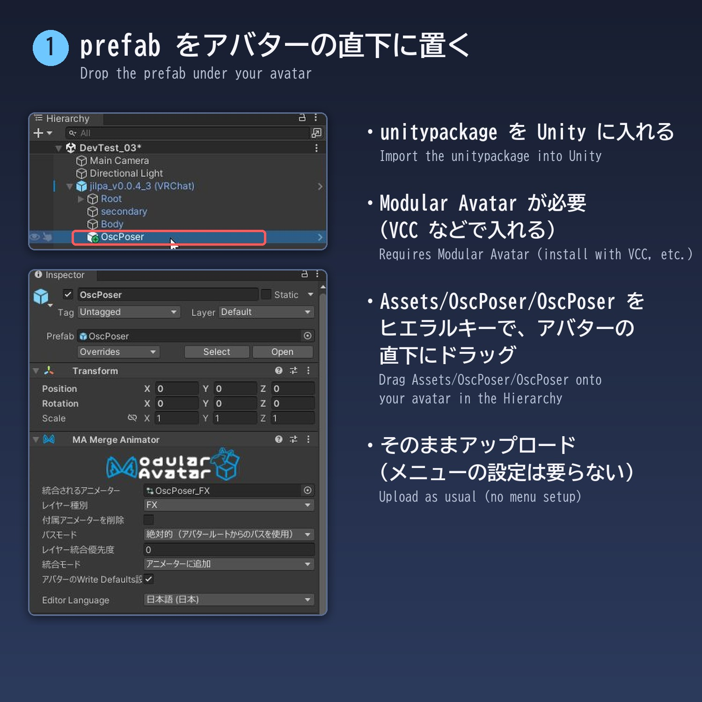
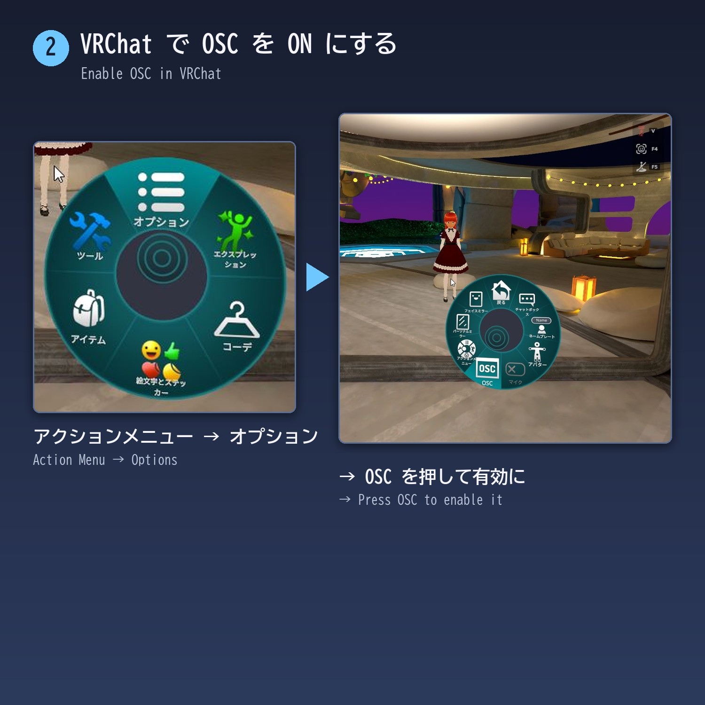
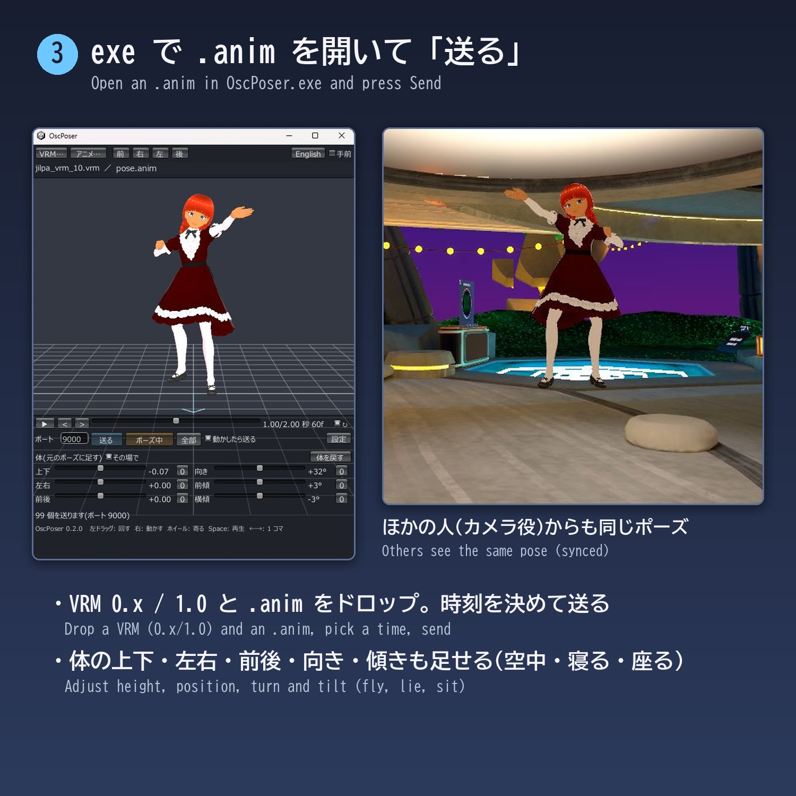

# OscPoser

どんな人型の .anim のポーズでも、あとから OSC で VRChat のアバターにとらせるツールです。
Modular Avatar 用の prefab と、ポーズを見て送る小さなアプリ(exe)からなります。
一度 prefab を入れてアップロードすれば、あとはポーズを増やすのに Unity を開く必要はありません。

(English: [README.en.md](README.en.md))

Claude Code(Claude Opus 5.5)が、私(JRF)のためにオーダーメイドで作ってくれたツールのおすそわけです。私はワールドの取材でアバターを撮影するのに使っています。

VRChat とは関係のない、非公式のツールです。

## できること

- アバターに prefab を一つ置いてアップロードするだけで、OSC から任意のポーズをとれるようになります。Expressions メニューの設定は要りません。
- exe に VRM と .anim をドロップし、時刻を決めて「送る」と、VRChat のアバターがその瞬間の姿勢になります。
- 体の上下・左右・前後・向き・傾きも足せます。空中に浮く、寝そべる、何もない所に座る、など、エモートではできない姿勢もとれます。
- 同期するので、ほかの人(カメラ役など)からも同じポーズに見えます。
- VRM 0.x / 1.0 のどちらも exe で表示できます。exe の画面は日本語と英語です。

## 必要なもの

- Windows 10 / 11(64 bit)。exe は Windows 用です。
- VRChat(PC 版)。私が確かめたのはデスクトップモードです。
- アバターの Unity プロジェクト(Unity 2022.3、VRChat SDK3 Avatars)に **Modular Avatar**(VCC で入れる)。
- アバターと同じ体型の VRM ファイル(exe での表示用。VRoid Studio などで書き出したもの)。なくても送れますが、ポーズを見ながら選べません。
- 人型(Humanoid)のアニメーションの .anim ファイル(テキスト形式)。Unity のプロジェクトにあるものや、アセットに入っているものがそのまま使えます。FBX の中のアニメーションは読めません。

## 入れ方

[Releases](https://github.com/JRF-2018/osc_poser/releases) か Booth から zip をダウンロードして、好きな所に展開します。

1. Unity のアバターのプロジェクトに、Modular Avatar を VCC で入れておきます。
2. zip の中の `OscPoser_x.y.z.unitypackage` を Unity に入れます(ドラッグするか、Assets → Import Package → Custom Package)。
3. `Assets/OscPoser/OscPoser`(prefab)を、ヒエラルキーでアバターの直下にドラッグします。
4. いつもどおりアップロードします。

5. VRChat で、アクションメニュー → オプション → OSC を ON にします。

## 使い方

1. VRChat で、prefab を入れたアバターを着ます。
2. `OscPoser.exe` を起動し、VRM と .anim を窓にドロップします(「VRM…」「アニメ…」のボタンからも開けます)。前に開いた VRM は覚えています。
3. 下の時間のバーで、とりたい瞬間を選びます(▶ で再生、< > で 1 コマずつ)。
4. 「送る」を押します。値を送り終えると、任意ポーズが ON になります。
5. 「ポーズ中」を押すと OFF になり、普通に戻って歩けます。

### 画面の項目

| 項目 | 説明 |
|---|---|
| ポート | VRChat の OSC の受信ポート。普通は 9000 のまま |
| 送る | 今の姿勢を送り、任意ポーズを ON にする。前に送った値から変わったものだけを送る |
| ポーズ中 / ポーズ OFF | 任意ポーズの ON・OFF |
| 全部 | 全部の値を送り直す(VRChat でアバターを読み直したあと、後からインスタンスに入った人に見せたいとき) |
| 動かしたら送る | 時刻や体のスライダーを動かして手を止めると、変わった値を送る |
| 体(元のポーズに足す) | 上下・左右・前後(±1.5、人型の単位)、向き(±180 度)、前傾(±180 度)、横傾(±90 度)。「0」でその軸を戻す、「体を戻す」で全部戻す |
| その場で | アニメーションの左右・前後の移動を使わない(ON が既定) |
| 設定 | 送る速さ(下の「仕組み」を参照) |
| 手前 | exe の窓をいつも手前に出しておく |
| English / 日本語 | 画面の言語 |

マウス: 左ドラッグで回す、右ドラッグで動かす、ホイールで寄る。キー: Space で再生、← → で 1 コマ、F で正面。

### ほかのエモートとの関係

- 任意ポーズ中にほかのエモートを選ぶと、任意ポーズは終わり、そのエモートになります。
- エモート中に「送る」と、そのエモートを止めて、少し(0.6 秒)待ってから任意ポーズになります。

## 仕組みと注意

- 同期に使うのは 17 bit だけです(`OscPoser/On` Bool、`OscPoser/Idx` Int、`OscPoser/Val` Float)。ポーズの値(筋肉 93 個と体の位置・向き 6 個)は、同期しないパラメーターに、番号と値を一組ずつ送って写します。Parameter Driver の Copy が全員の側で動くので、ほかの人にも同じポーズが見えます。
- 一組の送信に約 0.125 秒かかります。全部(99 個)で約 12 秒です。同じアニメーションの別の時刻なら、変わった値だけを送るので速くなります。送っている途中は、少しずつ姿勢が変わります。
- ほかの人の側では、同期の間隔より速く番号を変えると値を取りこぼします。カメラ役などで姿勢がおかしいときは、「設定」で待ち時間を長くしてください(既定: 値のあと 0.025 秒、番号のあと 0.1 秒、0 のあと 0.1 秒、「0 を挟まない」ON)。
- 後からインスタンスに入った人には、それまでの値が届きません。「全部」で送り直してください。
- 前にアップロードしたアバターに prefab を足して上げ直した場合、VRChat の OSC の設定ファイルが古いままで、新しいパラメーターが届かないことがあります。そのときは、アクションメニュー → オプション → OSC → Reset Config を押すか、`%USERPROFILE%\AppData\LocalLow\VRChat\VRChat\OSC\` の中の、そのアバターの設定ファイルを消してください。
- 筋肉の値は ±4 まで(エモートには 1 を超える値がよくあります)。体の位置は ±1.5、向き・前傾は ±180 度、横傾は ±90 度までです。
- ポーズは Action レイヤーに入ります(Modular Avatar が、アバターの Action に足します)。値を写すレイヤーは FX に足します。アバターが自前の FX を使っていても(XAvatar など)動きます。
- 確かめた環境: VRChat(PC、デスクトップモード)、VRoid の VRM 0.x を VRM Converter for VRChat で変換したアバター、XAvatar(XWear Packager)。VR モードでは試していません。

### パラメーター(ほかのツールから使う人向け)

送り方: `OscPoser/Val` に値(-1〜1)→ 少し待つ → `OscPoser/Idx` に番号 → 待つ →(次の組)→ 最後に `OscPoser/Idx` を 0。`OscPoser/On` を true で任意ポーズ。

| 番号 | 中身 | 値 ±1 の意味 |
|---|---|---|
| 1〜93 | 人型の筋肉(順番は [PoseParams.cs](app/Assets/OscPoserApp/Scripts/PoseParams.cs) の `MuscleNames`) | 筋肉 ±4 |
| 94 / 95 / 96 | 体の上下 / 左右 / 前後(RootT.y − 1 / x / z) | ±1.5 |
| 97 | (欠番) | |
| 98 / 99 / 100 | 体の向き(Yaw)/ 前傾(Pitch)/ 横傾(Roll)。Unity の YXZ の順 | ±180 / ±180 / ±90 度 |

## ソースから作る(開発者向け)

- `unity/`: prefab(`Assets/OscPoser`)を作るエディターのスクリプト。VCC で Avatar のプロジェクトを作って Modular Avatar を入れ、`unity/Assets/OscPoserDev` をその `Assets` に入れて、メニューの Tools → OscPoser → Build で作ります。Tools → OscPoser → Export unitypackage で unitypackage を書き出します。
- `app/`: exe の Unity プロジェクト(Unity 2022.3.22f1、UniVRM 0.128.1)。`app/build.ps1` でバッチモードでビルドします(書き出し先は中の `$Out`)。

## Author (文責)

JRF ( http://jrf.cocolog-nifty.com/statuses , Twitter (X): @jion_rockford )
AI

Claude Opus 5.5 がほとんどを書きました。

## ライセンス

MIT License（LICENSE）.

exe には UniVRM(MIT License)が入っています。[THIRD_PARTY_NOTICES.md](THIRD_PARTY_NOTICES.md) を見てください。
